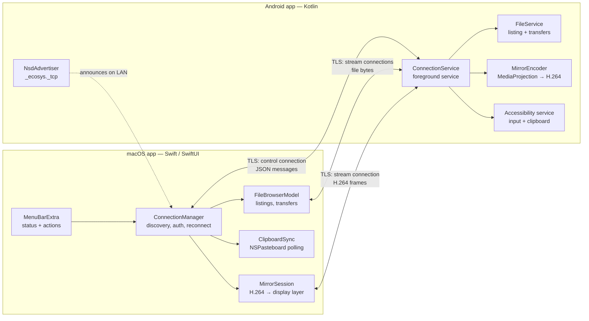
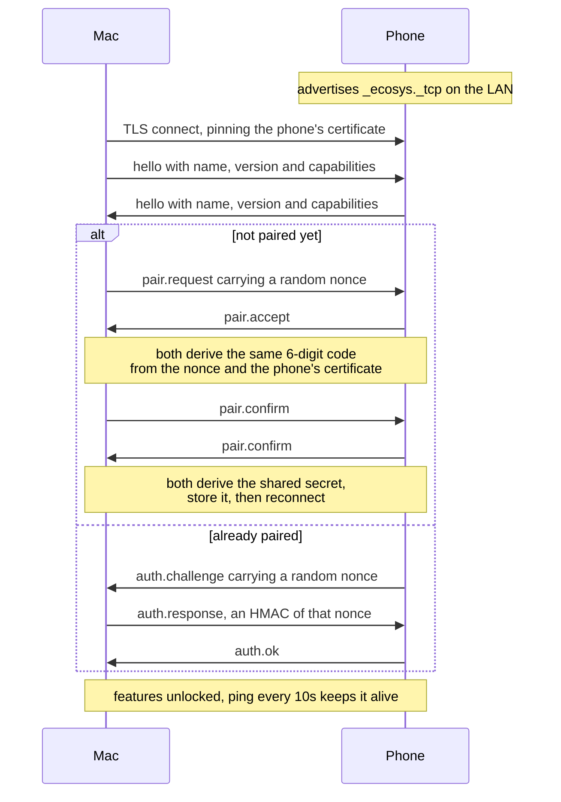

# How Ecosystem works

This explains the system twice: first in plain language, then in technical detail.

---

## Part 1 — The short version

Ecosystem makes your Android phone and your Mac behave like one set of devices, the
way an iPhone does with a Mac. Copy on one, paste on the other. Browse the phone's
photos in a window on the Mac. See and control the phone's screen from the Mac's
keyboard and trackpad. Make the phone ring when it's lost down the sofa.

**Everything happens directly between the two devices over your own Wi-Fi.** Nothing
is uploaded, no account is needed, no company's server is involved. If your internet
goes down, this still works.

### How they find each other

When the phone app starts, it shouts its name on the local network — the same
mechanism printers use to appear in your Mac's printer list without you typing an
address. The Mac listens for that shout and connects. That's why both devices must be
on the same Wi-Fi.

### How they know it's really you

The first time, the two apps show a **six-digit code**. You check the numbers match
and confirm on both. That single act does two things: it proves nobody is
impersonating your phone, and it lets both devices secretly agree on a shared password
that only they know.

From then on, every connection is encrypted, and the phone challenges the Mac to prove
it knows that password before it will do anything. A stranger on your Wi-Fi cannot
connect, read your clipboard, or see your screen.

### Who asks whom

The phone is the "host" and the Mac is the "guest": the Mac always makes the calls,
the phone answers. This matters because it means the phone never needs to know your
Mac's address, and it keeps working when your Mac's address changes — coming home,
switching networks, waking from sleep.

```
        Your Wi-Fi network
   ┌──────────────────────────────┐
   │                              │
   │   Mac  ──── connects to ───▶ Phone
   │   (asks)                  (answers)
   │                              │
   └──────────────────────────────┘
     no cloud, no cable, no account
```

### What travels between them

| Feature | What actually happens |
|---|---|
| **Clipboard** | Whenever you copy, the text is sent to the other device and put on its clipboard. A few hundred bytes. |
| **Ring** | The Mac says "ring"; the phone plays its alarm sound at full volume, even on silent. |
| **Files** | The Mac asks "what's in this folder?" and gets a list back. Downloading opens a second, separate connection just for that file's bytes, so a big video doesn't block everything else. |
| **Screen mirroring** | The phone compresses its screen into video (the same H.264 format as a video file) and streams it. Your clicks and keystrokes travel back the other way as instructions like "tap here" or "type this". |

### The one thing Android won't allow

The phone's screen must stay **on** while mirroring. Android deliberately blocks
normal apps from recording a screen that's switched off — only tools with
developer-level privileges over USB can do that. Ecosystem works with the limit rather
than around it: it wakes the phone when you start mirroring, keeps it awake for the
session, and offers a **Dim phone** button so the screen is nearly black and uses
little battery while you work from the Mac.

---

## Part 2 — The technical view

### System layout



### Two kinds of connection

Everything runs over TLS on a port the phone picks at random and publishes via mDNS.

- **Control connection** — one per session, long-lived. Carries JSON messages framed
  as `[4-byte length][JSON]`: hello, auth, clipboard, ring, file listings, mirror
  start/stop, and all input events.
- **Stream connections** — short-lived, one per transfer or video stream. Opened by
  the Mac, identified by a one-time token issued on the control connection, then
  switched to binary frames: `[length][type][timestamp][payload]`. This keeps a 500 MB
  download or a video stream from starving the control channel.

### Connecting, step by step



Until `auth.ok`, the phone refuses every message except the handshake itself.

### Security model

| Concern | How it's handled |
|---|---|
| Eavesdropping | TLS on every connection, control and streams alike. |
| Impersonating the phone | The Mac pins the phone's exact certificate at pairing; a different certificate is refused. |
| Impersonating the Mac | The Mac proves possession of the shared secret with an HMAC challenge-response on every connection. There is no TLS client certificate — that required a macOS keychain, which prompted for a password on every rebuild. |
| Man-in-the-middle during pairing | The six-digit code covers both the pairing nonce and the phone's certificate, so a relay produces different numbers on the two screens. |
| Secrets at rest | Phone: app-private storage. Mac: `~/Library/Application Support/Ecosystem/`, mode 0600. No keychain. |

### Staying connected

Wi-Fi drops, sleep, and going out of range all break the link, and macOS's network
browser dies silently when the network changes. Three mechanisms bring it back:

1. The browser restarts on failure, on wake from sleep, and on a 15-second watchdog.
2. Failed dials retry with backoff and rotate between discovered addresses, because a
   stale record can linger in caches after the phone app restarts.
3. The phone re-announces itself whenever the network changes, and only ever runs one
   server socket, so its port never changes underneath the Mac.

### Feature internals

**Clipboard.** Mac→phone is straightforward: macOS has no clipboard-change
notification, so the app polls the pasteboard once a second and sends what changed.
Phone→Mac is harder — One UI refuses clipboard reads to apps that aren't in focus,
and the exemption stock Android grants accessibility services doesn't apply. The
workaround: the accessibility service watches for the system "Copied" bubble, then
flashes an invisible 1×1 focusable window, which makes the app briefly the focused app
and the read legal. Both sides suppress echoes by hashing content.

**Files.** The phone exposes `/storage/emulated/0`, canonicalising every path and
rejecting anything that escapes that root. Listings and thumbnails (JPEG, base64) come
back on the control connection; file bytes move over a stream connection in 256 KB
chunks with a SHA-256 checksum verified at the far end. Image and video filters run a
recursive sweep on the phone rather than filtering one folder on the Mac.

**Mirroring.** MediaProjection feeds a hardware H.264 encoder; frames go out as
Annex-B, with the codec configuration re-sent before every keyframe so the Mac can
join at any point. The Mac rebuilds them into sample buffers and hands them to an
`AVSampleBufferDisplayLayer`. Android 14+ allows only one capture per consent, so
closing the window doesn't tear the capture down — it stays warm for ten minutes, and
re-opening reattaches instantly with a forced keyframe. That's why you only approve
once.

**Remote control.** Clicks, drags and keystrokes become normalised 0–1 coordinates —
resolution- and rotation-independent — that the accessibility service replays as
gestures. Trackpad scrolling is one continuous drag built from Android's continued
strokes, rather than a series of flicks, so the phone's own fling physics apply.
Typing pastes the first character at the cursor (an empty field reports its
placeholder as its text, and many apps expose no way to tell the difference), then
tracks the content from there.

### Where things live

```
mac-app/Ecosystem/
  Core/          protocol codec, framing, pairing, discovery, connections
  Features/      clipboard, file browser, mirroring, streams
  UI/            menu bar, file browser window, mirror window
android-app/app/src/main/kotlin/com/akram/ecosystem/
  core/          protocol codec, framing, pairing, identity, TLS server
  service/       the always-on foreground service
  features/      clipboard, ring, screen encoder
  accessibility/ input injection and clipboard reading
  ui/            status screen and permission prompts
docs/            these documents, plus protocol.md (the exact wire format)
scripts/         build and packaging
```

The two codecs are written independently but must produce identical bytes;
[protocol.md](protocol.md) is the contract they both follow.
