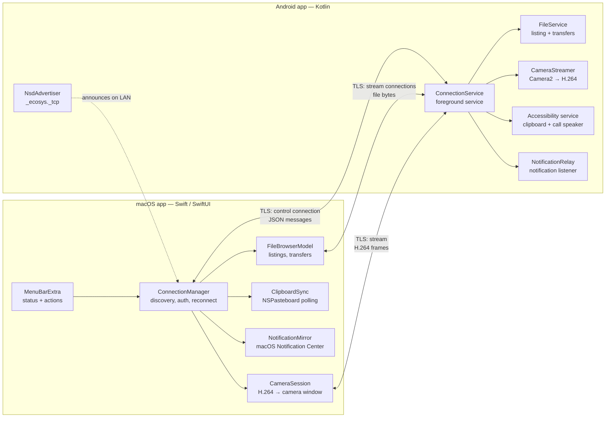
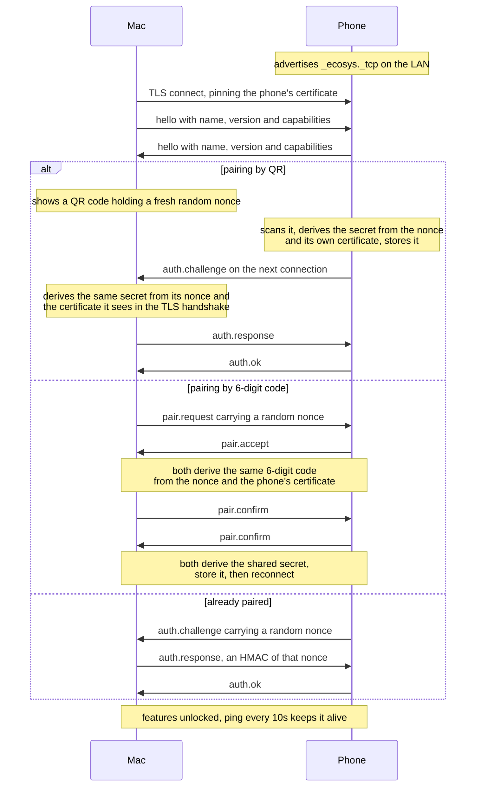

# How Ecosystem works

This explains the system twice: first in plain language, then in technical detail.

---

## Part 1 — The short version

Ecosystem makes your Android phone and your Mac behave like one set of devices, the
way an iPhone does with a Mac. Copy on one, paste on the other. See the phone's
notifications on the Mac and reply from there. Answer calls from the Mac. Browse the
phone's photos in a window. Look through the phone's cameras from the Mac. Make the
phone ring when it's lost down the sofa.

**Everything happens directly between the two devices over your own Wi-Fi.** Nothing
is uploaded, no account is needed, no company's server is involved. If your internet
goes down, this still works.

### How they find each other

When the phone app starts, it shouts its name on the local network — the same
mechanism printers use to appear in your Mac's printer list without you typing an
address. The Mac listens for that shout and connects. That's why both devices must be
on the same Wi-Fi.

The phone app also starts itself: after a reboot, and after being updated. You never
have to open it for the connection to come back.

### How they know it's really you

The first time, you pair — once per Mac, and a phone can be paired with several Macs.
Two ways, same result:

- **Scan a QR code.** The Mac shows a code, the phone scans it. Being able to see the
  Mac's screen *is* the proof the two devices belong together — nothing to compare,
  nothing to type. Codes expire after a few minutes and work once.
- **Compare six digits.** Both screens show the same six-digit number; you check they
  match and confirm on both.

Either way, both devices end up agreeing on a shared password that only they know —
and the password itself never crosses the network, not even during pairing.

From then on, every connection is encrypted, and the phone challenges the Mac to prove
it knows that password before it will do anything. A stranger on your Wi-Fi cannot
connect, read your clipboard, or see your screen.

To undo it: the Mac's menu has **Forget this phone**, and the phone lists its paired
Macs with a **Remove** button next to each. Removing a Mac cuts its access instantly.

### Who asks whom

The phone is the "host" and the Mac is the "guest": the Mac always makes the calls,
the phone answers. This matters because it means the phone never needs to know your
Mac's address, and it keeps working when your Mac's address changes — coming home,
switching networks, waking from sleep.

```
        Your Wi-Fi network
   ┌──────────────────────────────┐
   │                              │
   │   Mac  ──── connects to ───▶ Phone
   │   (asks)                  (answers)
   │                              │
   └──────────────────────────────┘
     no cloud, no cable, no account
```

### What travels between them

| Feature | What actually happens |
|---|---|
| **Clipboard** | Whenever you copy, the text is sent to the other device and put on its clipboard. A few hundred bytes. |
| **Notifications** | The phone forwards each notification's app name, title, text and buttons. Clicking a button on the Mac presses the real button on the phone; typing in the Mac's reply field sends the reply through the phone. Dismissing on either side clears the other. |
| **Calls** | An incoming call is just a notification with Answer and Decline buttons, so those work from the Mac like any other button. After Answer, the phone flips itself to speakerphone. (The voice itself stays on the phone — Android only lets the manufacturer's own apps touch call audio.) |
| **Ring** | The Mac says "ring"; the phone plays its alarm sound at full volume, even on silent. |
| **Files** | The Mac asks "what's in this folder?" and gets a list back. Downloading opens a second, separate connection just for that file's bytes, so a big video doesn't block everything else. |
| **Camera** | The phone streams whichever camera you pick — every lens, with zoom — as compressed video (the same H.264 format as a video file) into a window on the Mac. |

### Why there is no screen mirroring

There used to be — video, sound, full remote control from the Mac's keyboard and
trackpad. It was removed on purpose. Android blocks normal apps from recording a
switched-off screen and demands a consent tap after every reboot, so mirroring could
never feel like iPhone Mirroring — the phone had to lie there switched on with its
screen glowing. A feature that almost works reads as broken, so it came out; the
whole implementation is one commit away in git history if you want to resurrect it.

---

## Part 2 — The technical view

### System layout



The phone talks to **every paired Mac at once**: each connected Mac gets its own
session, notifications and clipboard changes are broadcast to all of them, and each
Mac holds its own shared secret, so removing one never affects another.

### Two kinds of connection

Everything runs over TLS on a port the phone picks at random and publishes via mDNS.

- **Control connection** — one per Mac, long-lived. Carries JSON messages framed
  as `[4-byte length][JSON]`: hello, auth, clipboard, ring, notifications, and file
  listings.
- **Stream connections** — one per transfer or video stream. Opened by the Mac,
  identified by a one-time token issued on the control connection, then switched to
  binary frames: `[length][type][timestamp][payload]`. File bytes and camera video
  each get their own stream, so a 500 MB download or a video stream never starves
  the control channel.

### Connecting, step by step



Until `auth.ok`, the phone refuses every message except the handshake itself. A Mac it
doesn't recognise gets a `pair_required` error and no session.

### Security model

| Concern | How it's handled |
|---|---|
| Eavesdropping | TLS on every connection, control and streams alike. |
| Impersonating the phone | The Mac pins the phone's exact certificate at pairing; a different certificate is refused. |
| Impersonating the Mac | Each Mac proves possession of its own shared secret with an HMAC challenge-response on every connection. There is no TLS client certificate — that required a macOS keychain, which prompted for a password on every rebuild. |
| Man-in-the-middle during pairing | 6-digit route: the code covers both the pairing nonce and the phone's certificate, so a relay produces different numbers on the two screens. QR route: the secret is derived from the certificate seen in the TLS handshake, so a relay derives a different secret and fails authentication. |
| Someone photographing the QR code | The code expires after five minutes, works once, and is only shown when you open the pairing window. |
| Secrets at rest | Phone: app-private storage, one secret per Mac. Mac: `~/Library/Application Support/Ecosystem/`, mode 0600. No keychain. |

### Staying connected

Wi-Fi drops, sleep, reboots and going out of range all break the link, and macOS's
network browser dies silently when the network changes. On the Mac:

1. The browser restarts on failure, on wake from sleep, and on a 15-second watchdog.
2. Failed dials retry with backoff and rotate between discovered addresses, because a
   stale record can linger in caches after the phone app restarts.

On the phone:

3. It re-announces itself whenever the network changes, and only ever runs one server
   socket, so its port never changes underneath the Mac.
4. A boot receiver starts the service after every reboot and app update, and the
   system's early binding of the notification listener acts as a backup trigger — so
   the connection comes back without anyone opening the app.

### Feature internals

**Clipboard.** Mac→phone is straightforward: macOS has no clipboard-change
notification, so the app polls the pasteboard once a second and sends what changed.
Phone→Mac is harder — One UI refuses clipboard reads to apps that aren't in focus,
and the exemption stock Android grants accessibility services doesn't apply. The
workaround: the accessibility service watches for the system "Copied" bubble, then
flashes an invisible 1×1 focusable window, which makes the app briefly the focused app
and the read legal. Both sides suppress echoes by hashing content.

**Notifications.** A `NotificationListenerService` forwards each notification's app
name, title, text and button list; the Mac shows it through macOS's own Notification
Center, so it looks and behaves like any Mac notification. Buttons are pressed
remotely by index; buttons that accept inline reply carry the Mac-typed text in a
`RemoteInput`. Filtering keeps the noise down: group summaries, media players,
progress bars, silent channels and other apps' ongoing notifications stay on the
phone, and re-posts that change nothing are dropped (apps re-post constantly; the
phone only buzzes once, so the Mac only banners once). Incoming calls are the one
exception to the no-ongoing rule — they pass through by their `call` category, which
is what makes Answer and Decline work from the Mac. After an answer, the accessibility
service taps the in-call Speaker button, best-effort.

**Files.** The phone exposes `/storage/emulated/0`, canonicalising every path and
rejecting anything that escapes that root. Listings and thumbnails (JPEG, base64) come
back on the control connection; file bytes move over a stream connection in 256 KB
chunks with a SHA-256 checksum verified at the far end. Image and video filters run a
recursive sweep on the phone rather than filtering one folder on the Mac.

**Camera.** Camera2 streams whichever lens you pick into a hardware H.264 encoder;
frames go out as Annex-B with the codec configuration re-sent before every keyframe,
and the Mac rebuilds them into sample buffers for an `AVSampleBufferDisplayLayer`.
The lens list isn't hardcoded: the phone reads its own
camera characteristics, hides Android's synthetic duplicates, and derives the zoom
presets (0.6×, 1×, 3×…) from each lens's real field of view — so it adapts to any
phone. Making the feed appear as a selectable webcam in Zoom/Meet needs a macOS
system extension that requires a paid Apple developer account; until then it's a
viewing window.

### Where things live

```
mac-app/Ecosystem/
  Core/          protocol codec, framing, pairing, discovery, connections
  Features/      clipboard, file browser, camera, notifications
  UI/            menu bar, file browser, camera, pairing windows
android-app/app/src/main/kotlin/com/akram/ecosystem/
  core/          protocol codec, framing, pairing, identity, TLS server
  service/       the always-on foreground service + boot receiver
  features/      clipboard, ring, camera
  notifications/ the notification listener/relay
  accessibility/ clipboard reading + call speaker tap
  ui/            status screen and permission prompts
docs/            these documents, plus protocol.md (the exact wire format)
scripts/         build and packaging
```

The two codecs are written independently but must produce identical bytes;
[protocol.md](protocol.md) is the contract they both follow.
